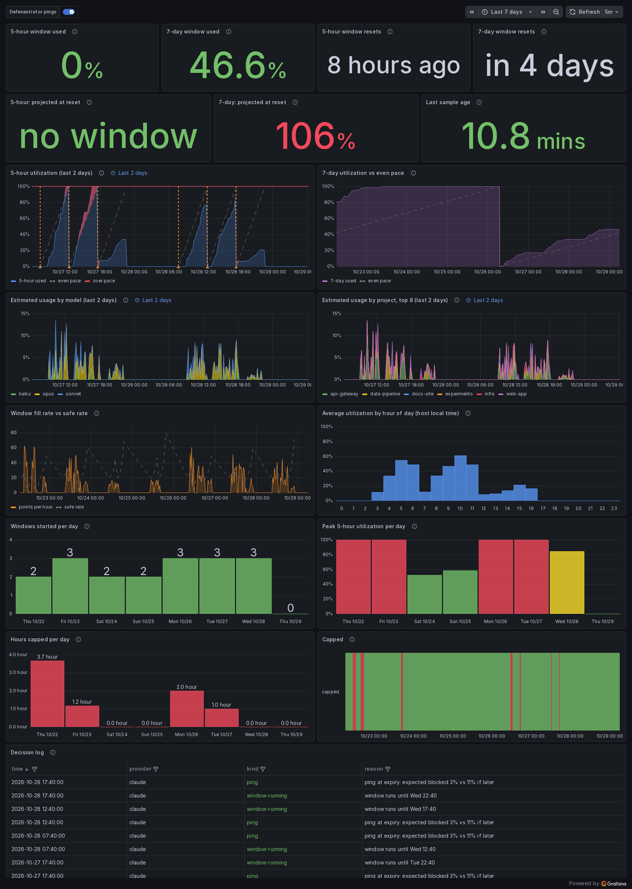

# Defenestrator

**Your Claude and Codex 5-hour limits reset on a schedule you never chose. Defenestrator makes
them reset when you need them to.**

<p align="center">
  
</p>
<p align="center"><sub>The board, running on invented demo data (<code>docker compose -f compose.demo.yaml up</code>).</sub></p>

## The problem

Claude and Codex subscriptions meter you in **5-hour windows**. A window opens with your first
message and closes five hours later. Spend the window's budget early and you wait for the reset,
however much you still have to do.

Whoever is first at your desk decides when the windows fall. Start at 9:00 and a heavy morning
caps out at 11:30 with the reset at 14:00: two and a half hours of nothing, in the middle of
your best working time.

## What Defenestrator does

It throws a spent window out and starts a fresh one **at the moment that helps you most**, by
sending one tiny message (`claude -p hi --model haiku`) with the official CLI before you sit down.

```
Without it    window 1: 09:00 ─────────────────────── 14:00   window 2: 14:00 ──── …
              you cap out at 11:30  ░░░░░ stuck until 14:00 ░░░░░

With it       window 1: 07:40 ───────────── 12:40   window 2: 12:42 ───────────── 17:42   window 3: 17:44 ─ …
              you cap out at 11:30  ░ stuck until 12:40 ░    a fresh budget at lunch    one more for the evening
```

Same plan, same weekly cap, but the resets now land in the middle of your day instead of after
it. On a heavy day that is the difference between two windows and three.

It learns **when** to do this. A ping that starts a window at the wrong hour wastes the budget,
so it replays your last 28 days of real usage against each candidate ping time and picks the one
with the least expected blocked work. Some days the right answer is "do nothing, your own first
message will start it".

## Why you'd want to run it

- **Fewer dead hours.** Heavy days get split across as many fresh windows as possible.
- **It tunes itself.** The policy comes from your own usage history (seeded from your Claude Code and
  pi session logs, then from account-wide samples every 10 minutes), not a fixed schedule.
- **You can see everything.** A ready-made Grafana board shows how fast you are burning each
  window, whether you are on course to hit a cap, which model and project is eating the budget,
  and a log of every decision it made and why.
- **It is boring to run.** One container, official CLIs only, no API keys, no scraping. A ping
  costs a one-word message to the smallest model.
- **Codex too.** On plans with a 5-hour window it does the same for Codex.

## Try it in 60 seconds, with nothing to log in to

```sh
git clone https://github.com/justmytwospence/defenestrator && cd defenestrator
docker compose -f compose.demo.yaml up --build
```

Open <http://localhost:3000/d/defenestrator>. It seeds two weeks of invented usage into a
throwaway InfluxDB and shows the real board. It never touches your logins and sends no pings.

## Run it for real

You need Docker, and `claude` logged in on the host with a claude.ai subscription (not an API
key). Codex is optional (a ChatGPT login on a plan with a 5-hour window).

```sh
cp .env.example .env     # three secrets, your TZ, and your uid/gid (see the comments in it)
docker compose up -d --build
```

Start with `DRY_RUN=1` in `.env` if you want to watch its decisions in the board's **Decision
log** for a day before it sends anything. Then remove it and `docker compose up -d`.

The container mounts `~/.claude` and `~/.codex` read-write so the CLIs can refresh their own
tokens, and uses the logins you already have. Prefer a separate login? See
[docs/operations.md](docs/operations.md#a-separate-login). Published images
(`ghcr.io/justmytwospence/defenestrator`, amd64 and arm64) are listed in
[docs/operations.md](docs/operations.md#using-the-published-image). Not using Docker? It is
standard-library Python: [run it from cron or systemd](docs/operations.md#without-docker).

## A tour of the board

Everything below is the demo data. The board lives in
[`deploy/grafana/defenestrator.json`](deploy/grafana/defenestrator.json) and every panel is
explained in [docs/dashboard.md](docs/dashboard.md).

### Are you burning the window too fast?


Account-wide 5-hour usage (every device, claude.ai included). The dashed line is an even pace
from 0% at the start of the window to 100% at its reset; the red band is where you are ahead of
it. Orange markers are windows the defenestrator started.

### Will you hit the weekly cap?


Weekly usage against a straight line to the next reset, plus a projection of where the week ends
up at your current rate ("7-day: projected at reset" on the board).

### What is eating the budget?


Estimated usage every 10 minutes, stacked by model and by project (the biggest eight), read from
your Claude Code and pi session logs. These line up with the 5-hour chart above, so you can see
which project filled which window.

### How fast, and is it safe?


The rate you are filling the window, against the **safe rate**: the steady pace that would land
you on exactly 100% at the reset. Above the dashed line, you are going to hit the cap early.

### Is it earning its keep?

 

Windows started per day (more is the point) and the hours you spent capped.

### Why did it do that?


Every ping, wait, skip and error with its reason, newest first. Nothing it does is a black box.

## How it decides

Every 10 minutes it samples your account-wide usage. When no window is running, it replays each
of your last 28 days (same weekday type when there are enough, recent days weighted more) from
the current time for "ping now", "ping in 10 minutes … 8 hours" and "no ping", and picks the
lowest expected blocked demand over the next 24 hours. Ties go to not pinging. For its first
week it simply pings when a window expires while it learns. The full model, with its constants
and its limits, is in [docs/how-it-works.md](docs/how-it-works.md).

## Configuration

| Variable | Meaning |
|---|---|
| `DRY_RUN=1` | Log decisions only, send nothing |
| `QUIET_HOURS=1-7` | Local hours with no pings (sampling continues) |
| `CLAUDE_MODEL` | Model for the ping, default `haiku` |
| `CODEX=off` | Skip Codex |
| `CODEX_MODEL` | Model for the Codex ping (default: Codex's own) |
| `TICK_SECONDS` | Longest wait between runs, default 600 |
| `SEED_HOSTS` | ssh hosts whose session logs also seed the profile |
| `INFLUX_URL`, `INFLUX_TOKEN`, `INFLUX_ORG`, `INFLUX_BUCKET`, `INFLUX_HOST_TAG` | InfluxDB output (optional) |
| `DEFENESTRATOR_STATE` | State directory (`/state` in the image) |

## FAQ

**Does it give me more usage?** No. Your weekly cap is unchanged and a window is never larger.
It changes **when** the 5-hour windows fall, so a heavy stretch of work spans more of them.

**What does a ping cost?** One word to the smallest model, against a window budget that real work
fills in a few hours. It is lost in the noise, and it only fires when it expects to gain.

**Is this allowed?** It uses the official CLIs, with your own subscription login, sending one
short message at a time, the same thing you could do by hand. Providers' terms change, so read
yours; you are responsible for how you use your account.

**Does it use an API key?** Never. Subscription logins only, and `ANTHROPIC_API_KEY` and friends
are removed from the CLIs' environment so nothing can be billed to the API by accident.

**What does it do with my credentials?** The OAuth token is read from `~/.claude/.credentials.json`
to ask the usage endpoint how full your window is, and is never printed, logged or written
anywhere else. The scheduler itself only talks to Anthropic (and OpenAI, for Codex) through their own CLIs and endpoints, and to your own InfluxDB.

**Do I need Grafana and InfluxDB?** No. They are only for the board. The scheduler works from its
own files; set no `INFLUX_*` variables and it runs standalone.

**What if I also use Claude on my phone or another machine?** That is the point of sampling
account-wide usage: a window you started elsewhere is seen and respected.

## Caveats

- The usage endpoint is the one Claude Code's own status line calls. It is not a documented API
  and may change; the sampler degrades to "no sample" rather than guessing.
- Credentials are shared with the host's CLIs. If you run Claude Code on the host while the
  container runs, both may refresh the same token file. This has been fine; it is the one place
  to look if a login ever drops.
- The usage-by-model/project panels are an estimate from the session logs on the machine running
  the defenestrator (see [docs/dashboard.md](docs/dashboard.md#estimated-usage)).
- The learned policy is a heuristic. `defenestrator report` shows its reasoning.

## More

- [docs/how-it-works.md](docs/how-it-works.md): the windows, the policy, the data flow and the files
- [docs/dashboard.md](docs/dashboard.md): every panel, and how its numbers are made
- [docs/operations.md](docs/operations.md): install variants, upgrades, troubleshooting

## Develop

```sh
python3 -B -m unittest discover -s tests      # standard library only
```

CLI versions in the image are build args in the [`Dockerfile`](Dockerfile). Releases are tags
(`vX.Y.Z`) that publish the image; the changelog is in [CHANGELOG.md](CHANGELOG.md).

MIT licensed.
