# The board

There are two boards, linked to each other: `deploy/grafana/defenestrator.json` (Claude, uid `defenestrator`) and `deploy/grafana/defenestrator-codex.json` (Codex, uid `defenestrator-codex`; see [the Codex board](#the-codex-board)). The rest of this page describes the Claude board.

Both are provisioned together and use a hidden `datasource` variable, so they work with whatever InfluxDB (Flux) data source you have
connected to the data: the compose stack provisions one, and in an existing Grafana it picks the
first InfluxDB data source.

Time zones: charts follow your **browser** time zone. The hour-of-day chart and the daily bars use
the time zone set in their queries (`America/Denver` in the shipped file; change it at the top of
those queries).

## Top: right now

| Panel | What it shows |
|---|---|
| 5-hour window used | Gauge: account-wide 5-hour utilization at the last sample |
| 7-day window used | Gauge: weekly utilization at the last sample |
| 5-hour / 7-day window resets | When each window ends. A time in the past means no window is running |
| 5-hour: projected at reset | Where this window ends up at the rate of the last 90 minutes. 100 or more: you will hit the cap early. Shows "no window" when none is running |
| 7-day: projected at reset | Where the week ends up at the rate of the last 48 hours of this week |
| Last sample age | Age of the newest sample. Yellow after 25 minutes, red after an hour: the sampler is failing (see [operations](operations.md#troubleshooting)) |

## Utilization

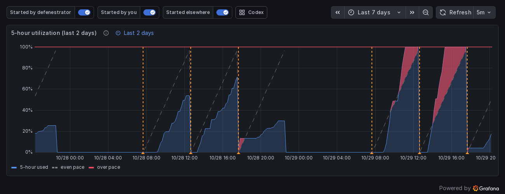

**5-hour utilization (last 2 days).** Account-wide 5-hour usage from the 10-minute samples. The
dashed line is an *even pace*: 0% at the start of the window (its reset minus five hours) rising
in a straight line to 100% at its reset. The red band is where your usage is above that line. Dashed
vertical lines mark every window start, coloured by what started it (see [What started a
window](#what-started-a-window)).
It shows two days on purpose: seven days of five-hour sawteeth is unreadable.

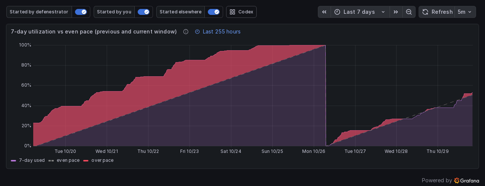

**7-day utilization vs even pace.** The same idea for the week: a straight line from 0% at the
last weekly reset to 100% at the next. It and the charts below it (how full each window got, fill
rate, capped) start at the beginning of the previous 7-day window and label days by weekday.

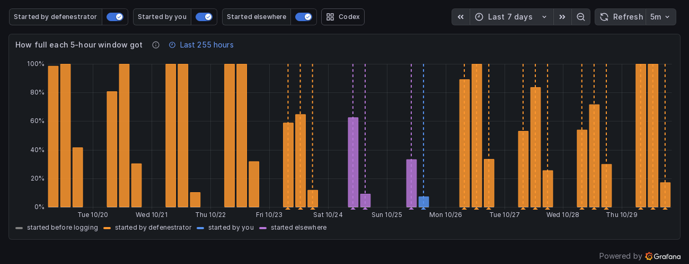

**How full each 5-hour window got.** One bar per window, placed where it started, as tall as the
highest utilization it reached, coloured by what started it.

## Estimated usage

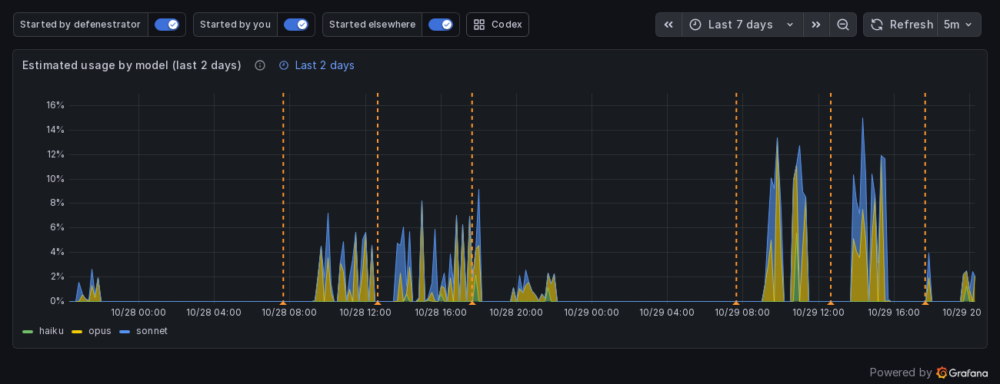
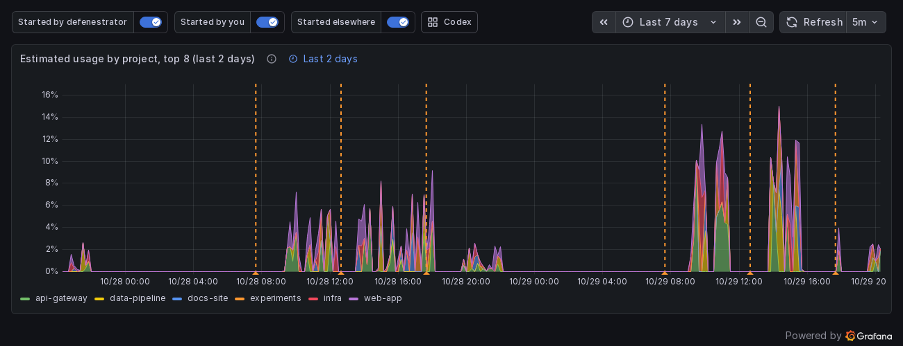

**Estimated usage by model / by project (last 2 days).** Percent of the 5-hour budget used in
each 10 minutes, stacked, over the same range and axis width as the 5-hour chart above so the two
line up.

This is an **estimate** and only a **subset** of the account total:

- It is computed from the Claude Code and pi session logs on the machine running the defenestrator
  (mount `~/.claude`, and `~/.pi/agent/sessions` for pi). Other devices and claude.ai are not in
  those logs.
- Cost is API-equivalent (tokens times list prices), converted at 0.58% of the 5-hour budget per
  dollar. The real exchange rate depends on your plan and changes over time.
- The project is the session directory, with worktrees counted toward their project. Only the eight
  biggest projects in the range are shown.

## Rate and safety

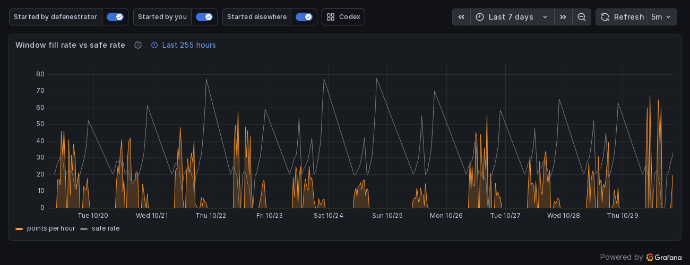

**Window fill rate vs safe rate.** The orange series is how fast the 5-hour window fills, in
percentage points per hour (smoothed over 30 minutes, resets excluded). The grey **safe rate** is
`(100 - used) / hours left`: the steady rate you could keep up from now and land on exactly 100%
at the reset. When orange is above grey, you will hit the cap before the reset. The safe rate is
not drawn in the last hour of a window, where it shoots towards infinity.

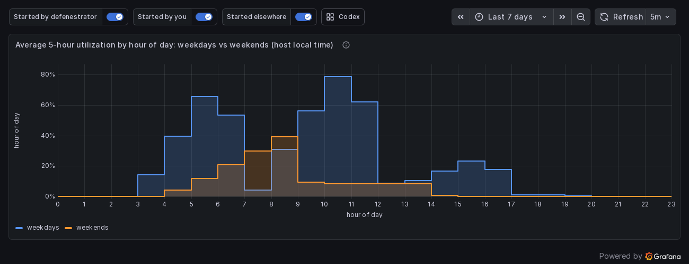

**Average utilization by hour of day: weekdays vs weekends.** Mean 5-hour utilization at each local
hour over the last 28 days (ignores the time range), as two overlaid step lines: when you usually work.

## Is it working?

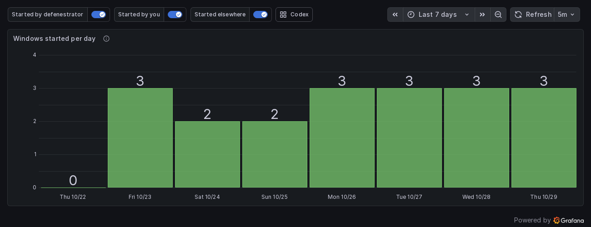

**Windows started per day.** A new window appears as a jump of about five hours in the reset time
between consecutive samples, however it started (a ping or your own first message). More windows
in a day is the point.

**Peak 5-hour utilization per day.** The highest utilization sampled each day. Days near 100 are
days a window ran out.

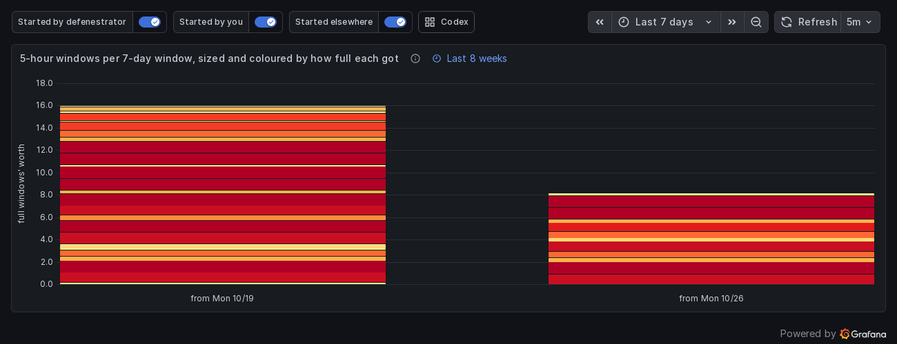

**5-hour windows per 7-day window.** One stacked bar per week, one segment per 5-hour window (first
at the bottom). Each segment is as tall as the share of the window used and coloured to match, pale
(barely used) to red (ran out), so a bar's height is how many full windows' worth you used that week.

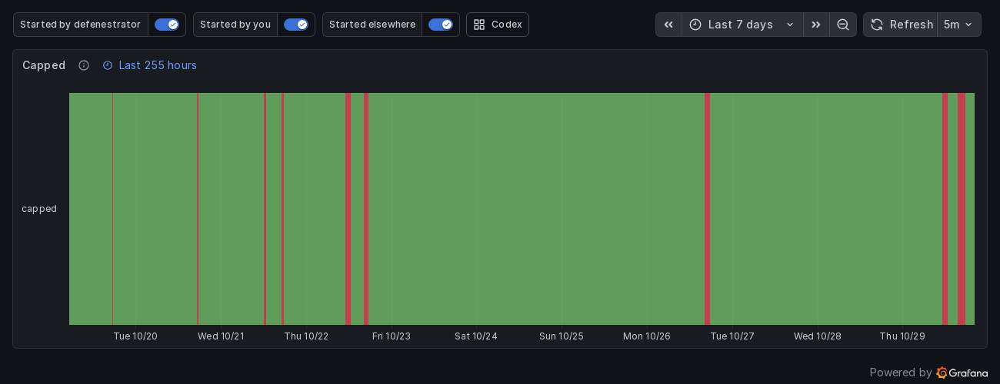

**Hours capped per day / Capped.** Time spent rate limited, counted as 10 minutes per capped
sample, and a timeline of when.

## Decision log

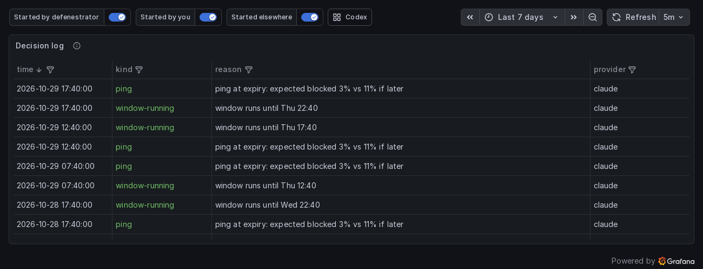

Every decision, newest first, from `defenestrator_event`. Kinds: **ping** (started a window),
**would-ping** (dry run), **wait** (planned a ping for later), **no-ping** (decided not to),
**window-running**, **quiet-hours**, **skip** (not installed, not logged in, plan without a
5-hour window) and **error** (for example an expired token).

## The Codex board

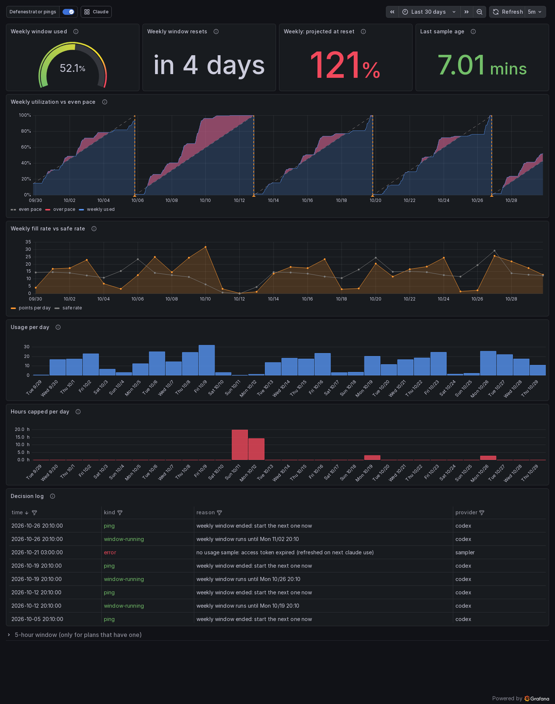

Weekly-first, for the window Codex plans actually have (default range 30 days):

| Panel | What it shows |
|---|---|
| Weekly window used / resets / projected at reset / last sample age | the weekly window right now; the projection uses the last 72 hours of the week |
| Weekly utilization vs even pace | usage against a straight line from 0% to 100% across the window; red above it; orange markers are weekly windows the defenestrator started |
| Weekly fill rate vs safe rate | percentage points per day against `(100 - used) / days left`, the steady rate that lands on exactly 100% at the reset |
| Usage per day | percentage points of the weekly window used each day |
| Hours capped per day | time rate limited |
| Decision log | Codex decisions (plus sampler errors) |
| 5-hour window (collapsed row) | for plans that have a 5-hour window: utilization against pace and windows started per day |

The usage-by-model/project panels are Claude only: Codex's logs are not priced.

## What started a window

Every window start gets a dashed vertical line on the 5-hour, model, project and fullness charts, and each one carries what we can actually know:

- **Orange: the defenestrator.** Its ping and why it chose that moment.
- **Blue: you.** The first message of the window found in the session logs on the machine the defenestrator runs on: the tool (pi or Claude Code), the session (pi's session name, else the start of your first prompt), the project, the model and the machine. That is the finest level the logs give; they do not record which login or token sent a message.
- **Purple: elsewhere.** No message in this machine's logs: another machine, the Claude app or claude.ai started it. (An API token would not start a subscription window at all.)
- **Grey (on the fullness chart): unknown.** The window is from before events were logged.

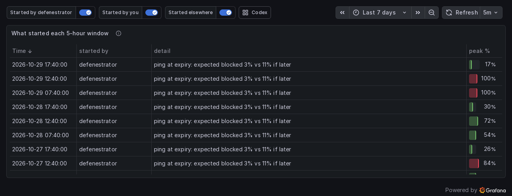

The "What started each 5-hour window" table lists the same, newest first, with how full each window got. After upgrading, `defenestrator backfill` describes the windows from your history. Before the first logged event, windows the old primer started cannot be told apart from yours and stay unknown.

## Time ranges

The 7-day charts (7-day utilization, how full each window got, fill rate, capped) start at the beginning of the previous 7-day window, so they always show the previous window and the current one, and their length changes as the week goes on. Grafana cannot extend a time axis into the future from data, so the 5-hour chart ends at now.

## Is it worth it?

Two charts answer this from different sides.

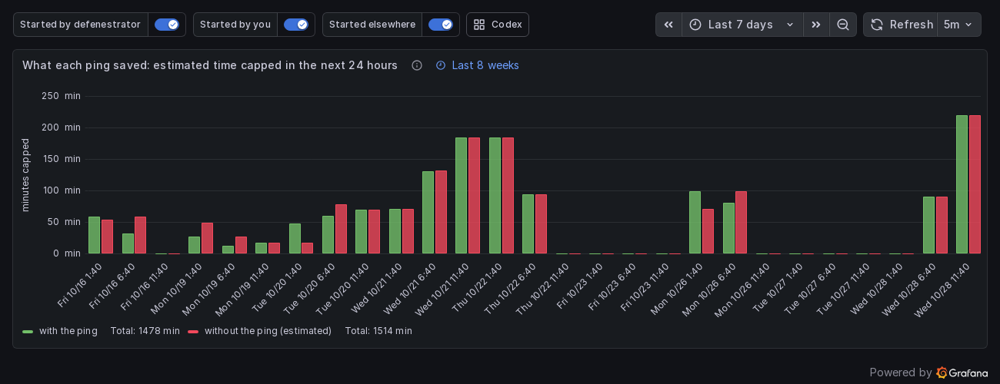

**What each ping saved** is the direct estimate. A day after each ping the defenestrator takes the demand actually seen over the next 24 hours (capped time filled in at your usual working rate) and replays it twice through the same window simulation the planner uses: once with the ping, once without it, where your own first message opens the window. The difference is the time capped the ping saved. It assumes you would have worked the same way, so read it as an estimate, and sum it over weeks rather than trusting one bar.

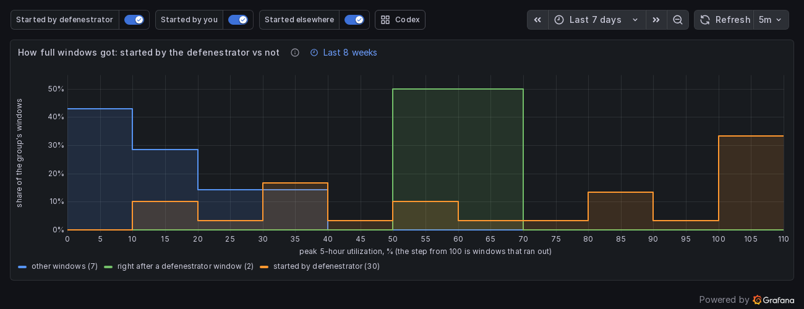

**How full windows got** shows the mechanism. A ping splits a stretch of work across two windows: the defenestrator's window takes the start and ends part-full, and the window right after it takes the rest. If pings help, that following window runs out less often than other windows do, so compare its step at 100 with the others'. The groups are not a controlled experiment: the defenestrator pings on days it expects heavy use.

## Customizing

The file is provisioned read-only (`allowUiUpdates: false`) so it stays in sync with the repo. To
change it, edit the JSON (or save a copy from the UI) and re-provision. Wait a few seconds between
edits: Grafana's database can briefly lock while it reloads provisioned dashboards.
